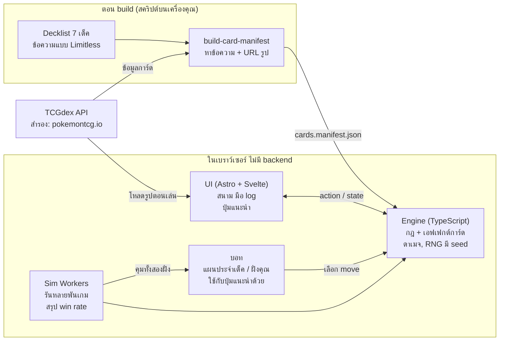

# แผนพัฒนา: เว็บจำลอง Matchup PTCG vs Top 5 Meta

Nov 14, 2026 · @Thammanun

> ฉบับนี้ export จาก Claude Docs เมื่อ 15 พ.ย. 2026 ฉบับที่แก้ล่าสุดอยู่ที่ https://claude.ai/artifact/YSAzuvDeHkWcaN7cfLKncJ แผนภาพในเอกสารต้นฉบับถูกแปลงเป็น Mermaid และตารางในไฟล์นี้

## เป้าหมายและขอบเขต

v1 คือเว็บที่คุณเล่น list ที่ให้ไว้ (Mega Kangaskhan / Ogerpon / Raging Bolt) กับบอทที่เล่นเด็ค top 5 ของ meta ตอนนี้ได้ครบตามกฎ พร้อมรูปการ์ดจริง หน้าเว็บทำด้วย Astro + Svelte v2 จะเพิ่มปุ่มแนะนำกับโหมดรันหลายพันเกมเพื่อดู win rate กับทั้ง meta

**ทำ**

- **ฝั่งคุณ:** list 60 ใบที่ให้ไว้ตามเดิม บน Limitless เด็คแบบนี้ใกล้กับ archetype ที่เรียกว่า Basic Box
- **ฝั่งบอท:** 5 เด็คแรกตาม meta share ในตารางข้างล่าง และใส่ Festival Lead (อันดับ 6) เป็นเด็คที่ 6 ได้ถ้าต้องการ
- โหมดที่ 1: คุณเล่นเองกับบอท / โหมดที่ 2: บอทเล่นกับบอทหลายพันเกม
- รูปการ์ดจริงจาก API ฟรี ถ้ารูปไหนโหลดไม่ได้จะแสดงเป็นกรอบข้อความแทน
- หน้าเว็บเป็นภาษาไทย ชื่อการ์ดและข้อความบนการ์ดเป็นภาษาอังกฤษ

**เด็คฝั่งบอท** (meta share จาก[หน้า meta ของ Limitless](https://limitlesstcg.com/decks) ณ 15 พ.ย. 2026 หน้าเว็บไม่ได้บอกช่วงเวลาชัด list อ้างอิงมาจาก Regional Gdańsk 31 ต.ค. ยกเว้น Festival)

| อันดับ | เด็ค | meta share | กลไกหลัก | list อ้างอิง |
| --- | --- | --- | --- | --- |
| 1 | [Dragapult ex](https://limitlesstcg.com/decks/284) | 36.50% | Phantom Dive ตีตัวหลักแล้วกระจายตัวนับดาเมจไป bench | [อันดับ 3](https://limitlesstcg.com/decks/list/29678) |
| 2 | [Basic Box](https://limitlesstcg.com/decks/339) | 8.86% | Ogerpon / Clefairy ใกล้เคียงเด็คคุณ เล่นเป็น mirror | [อันดับ 19](https://limitlesstcg.com/decks/list/31093) |
| 3 | [Slowking Seek Inspiration](https://limitlesstcg.com/decks/322) | 7.62% | Slowking ยืมท่าของการ์ดอื่นมาใช้ | [อันดับ 1](https://limitlesstcg.com/decks/list/30165) |
| 4 | [N's Zoroark ex](https://limitlesstcg.com/decks/320) | 7.29% | ยืมท่าของ N's Pokemon ตัวอื่น + ability จั่วการ์ด | [อันดับ 38](https://limitlesstcg.com/decks/list/31102) |
| 5 | [Alakazam Powerful Hand](https://limitlesstcg.com/decks/350) | 6.39% | ดาเมจตามจำนวนการ์ดในมือ | [อันดับ 9](https://limitlesstcg.com/decks/list/31085) |
| 6 (เสริม) | [Festival Lead](https://limitlesstcg.com/decks/336) | 5.70% | ตี 2 ครั้งต่อเทิร์น | [Nice อันดับ 1](https://www.limitlesstcg.com/decks/list/30783) |

กลไกในตารางเป็นภาพรวม ข้อความการ์ดจริงจะดึงมาตรวจในเฟส 0 ก่อนเขียนโค้ด

**ไม่ทำใน v1**

- ไม่รองรับการ์ดนอกเด็คในตารางข้างบน และยังไม่มีหน้าจัดเด็คแบบทั่วไป
- ไม่มีโหมดเล่นออนไลน์กับคนอื่น ไม่มีระบบบัญชี และไม่มี backend
- บอทไม่ได้เก่งระดับแข่ง เล่นตามกฎที่เขียนไว้เท่านั้น

**เกณฑ์ว่าเสร็จ (เป้าหมาย)**

- บอทเล่นกันเองจบ 1,000 เกมติดต่อกันได้โดย invariant ไม่พังเลยสักครั้ง
- บอทคิดเทิร์นละไม่เกิน 200 ms
- รัน 1,000 เกมเสร็จภายในประมาณ 1 นาทีบนโน้ตบุ๊ก

## รูปการ์ดจริง

มี API ฟรี 2 ตัวที่ให้รูปการ์ด คือ TCGdex ที่ไม่ต้องใช้ key กับ pokemontcg.io ที่ต้องขอ key ฟรี ข้อจำกัดคือหน้า artifact ของ Claude บล็อกรูปและ fetch จากเว็บภายนอก เวอร์ชันที่มีรูปจริงเลยต้องรันบนเครื่องคุณเอง หรือโฮสต์ฟรีบน GitHub Pages / Cloudflare Pages

| แหล่ง | ค่าใช้จ่าย / key | รูป | หมายเหตุ |
| --- | --- | --- | --- |
| [TCGdex](https://tcgdex.dev/faq) (ตัวหลัก) | ฟรี ไม่ต้องใช้ key | แยกโฮสต์ที่ assets.tcgdex.net มีไฟล์ความละเอียด high (webp) และ low | ชุมชนช่วยกันดูแลข้อมูล บางใบอาจยังไม่มีรูป |
| [pokemontcg.io](https://cardgrader.ai/blog/tcgplayer-api-alternatives) (สำรอง) | ฟรี ต้องขอ key | มี | ทีมงานหันไปทำ Scrydex แล้ว ชุดใหม่อาจอัปเดตช้า |
| [Scrydex](https://www.scrapingbee.com/blog/pokemon-card-api/) | เริ่ม $29 ต่อเดือน | มี | ไม่ใช้ เพราะไม่ฟรี |

**ยังไม่ได้เช็คจริง:** คำสั่งเรียก API ตรงจากที่นี่โดนบล็อก เลยยังยืนยันไม่ได้ว่ามีรูปครบทุกชุดที่ใช้หรือเปล่า ของทั้ง 7 เด็ค (ชุดตั้งแต่ TWM, TEF, SCR, SFA, JTG ไปจนถึง POR, CRI, PBL) เฟส 0 จะเช็คเรื่องนี้ก่อนเริ่มทำอย่างอื่น

**วิธีดึงรูป**

1. เขียนสคริปต์ `build-card-manifest` อ่าน decklist รูปแบบ Limitless แล้วหาการ์ดทีละใบจากรหัสชุดและเลขการ์ด
2. รหัสชุดของ Limitless (เช่น POR) ไม่ตรงกับ id ใน API จะสร้างตารางจับคู่จาก endpoint รายชื่อชุดของ API เอง ไม่เดาเอา
3. หาใน TCGdex ก่อน ถ้าไม่เจอค่อยไป pokemontcg.io ถ้ายังไม่เจออีก ให้ใช้รูปจากการ์ดชื่อเดียวกันที่พิมพ์ชุดอื่น (เช่น Night Stretcher ที่มีหลายชุด ข้อความเหมือนกัน)
4. บันทึกผลเป็น `cards.manifest.json` (ชื่อการ์ด, URL รูป high/low, ได้มาจากแหล่งไหน) พร้อมรายงานว่าการ์ดไหนไม่มีรูป
5. ตอนเล่นจะโหลดรูปจาก URL ตรง ๆ: รูป low ในมือและบนสนาม รูป high ตอนกดดูการ์ด ใช้ `loading="lazy"` แล้วปล่อยให้เบราว์เซอร์เก็บ cache เอง
6. รูปไหนโหลดไม่ได้ (ออฟไลน์ หรือเปิดใน artifact) จะสลับไปแสดงเป็นกรอบข้อความที่มีชื่อ HP และท่า เกมยังเล่นต่อได้

**ลิขสิทธิ์:** รูปการ์ดเป็นของ The Pokemon Company ใช้เป็นเครื่องมือส่วนตัวแบบไม่หากำไร ไม่เอาไฟล์รูปใส่ไว้ใน repo ให้เก็บแค่ URL แล้วโหลดตอนเปิดใช้ ส่วน CDN รูปของ Limitless ไม่ใช่ API สาธารณะ ไม่ควรดึงรูปจากตรงนั้น

## สถาปัตยกรรมและ tech stack

กฎทั้งหมดอยู่ใน engine ที่เดียว หน้าเว็บ บอท และโหมดรันหลายเกมเรียก engine ตัวเดียวกัน ผลเลยไม่มีทางขัดกัน ตัวเว็บไม่มี backend เป็นไฟล์ static ทั้งหมด



โฮสต์เอง = มีรูปจริง · artifact ของ Claude = กรอบข้อความ

สคริปต์ตอน build ดึงข้อมูลการ์ดครั้งเดียวเก็บเป็น manifest ส่วนรูปจริงเบราว์เซอร์โหลดตรงจาก API ตอนเล่น

- **หน้าเว็บ: Astro + Svelte 5:** แต่ละหน้าเป็นไฟล์ static ส่วนที่ต้องโต้ตอบ (สนามเกม และโหมดรันหลายเกม) เป็น Svelte component ที่ฝังเป็น island
- **เครื่องมือ:** Node + npm, Vitest สำหรับ test (Astro build ด้วย Vite อยู่แล้ว ใช้ config เดียวกันได้) และ Playwright สำหรับ test หน้าเว็บ
- **engine ไม่ import อะไรจาก UI:** เป็น TypeScript ธรรมดา รันได้ทั้งใน Node (test และ sim จาก command line), ใน Svelte และใน Web Worker
- **state:** engine คืน state ใหม่ทุกครั้ง (ใช้ Immer ช่วยได้) ฝั่ง Svelte เก็บด้วย `$state.raw` เพื่อไม่ให้ Svelte ห่อ proxy ทั้ง object ใหญ่ แล้ว UI อัปเดตตามเอง undo และย้อนดู log ทำได้ง่าย

**แต่ละเครื่องมือใช้ตรงไหน**

| งาน | ใช้อะไร | หมายเหตุ |
| --- | --- | --- |
| ตั้งโปรเจกต์ | `npm create astro@latest` แล้ว `npx astro add svelte` | [integration ของ Astro รองรับ Svelte 5](https://docs.astro.build/de/guides/integrations-guide/svelte/) |
| dev / build | `npm run dev` / `npm run build` | build ออกมาเป็นไฟล์ static ใน `dist/` ไปวาง GitHub Pages ได้ |
| หน้าเกม | `<Game client:only="svelte" />` ใน `play.astro` | [ไม่ render ฝั่ง server ทำงานในเบราว์เซอร์อย่างเดียว](https://fitech101.aalto.fi/en/courses/designing-and-building-scalable-web-applications/part-4/7-astro-and-svelte) |
| decklist | Astro content collection (`src/content/decks/`) | หน้า /decks สร้างจากไฟล์ decklist ตอน build |
| test engine | Vitest | ใช้ config ของ Astro ผ่าน `getViteConfig()` |
| test หน้าเว็บ | Playwright | เล่นตาม seed จนจบเกมในเบราว์เซอร์จริง |
| สคริปต์ | `npx tsx scripts/build-card-manifest.ts`, `npx tsx scripts/sim.ts` | sim แบบ command line กระจายงานด้วย `worker_threads` ของ Node |
| ตรวจ type | `npx astro check` + `npx svelte-check` | ตรวจไฟล์ .astro และ .svelte |

**ข้อควรรู้:** ตัวแปร context ของ Svelte ส่งข้าม island ไม่ได้ ([ตัวอย่างปัญหานี้](https://github.com/ikikaiku/AstroJS-SvelteQuery)) เลยรวมสนาม มือ และ log ไว้ใน island เดียว ส่วน Web Worker ใช้รูปแบบ `new Worker(new URL('./worker.ts', import.meta.url), { type: 'module' })` ที่ Vite รองรับอยู่แล้ว

```text
astro.config.mjs            integrations: [svelte()]
src/pages/                  index.astro, play.astro, sim.astro, decks/[slug].astro
src/content/decks/          decklist ของคุณ + 6 เด็คบอท
src/components/             Game, Board, Hand, Log, CoachPanel, SimRunner (.svelte)
src/engine/                 core, damage, rng, cards/<ชื่อการ์ด>.ts
src/bots/                   core, plans/<เด็ค>.ts, player-policy, coach
src/sim/                    worker.ts, stats.ts
data/cards.manifest.json
scripts/build-card-manifest.ts
scripts/sim.ts              รันหลายพันเกมด้วย Node ไม่ต้องเปิดเบราว์เซอร์
tests/                      engine (Vitest), e2e (Playwright)
```

## โมเดลข้อมูลของ engine

engine เป็นฟังก์ชันบริสุทธิ์ `apply(state, action)` ที่คืน state ใหม่ ไม่รู้จัก UI เลย ส่วนที่ต้องสุ่ม (สับเด็ค โยนเหรียญ) ใช้ RNG ที่กำหนด seed เก็บไว้ใน state เลยเล่นเกมเดิมซ้ำและ undo ได้

```ts
type PlayerId = 'me' | 'bot';

interface PokemonSlot {
  stack: CardInst[];        // Basic อยู่ล่าง ตัวบนสุดคือร่างปัจจุบัน
  energy: CardInst[];
  tool?: CardInst;
  damage: number;
  playedOnTurn: number;     // ใช้เช็คกฎ evolve และ ability ที่ทำงานตอนลงจากมือ
  flags: { cantAttackNextTurn?: boolean; usedAbilities: string[] };
}

interface PlayerState {
  deck: CardInst[]; hand: CardInst[]; discard: CardInst[]; prizes: CardInst[];
  active?: PokemonSlot; bench: PokemonSlot[];
  turnFlags: { supporter: boolean; energyAttached: boolean; retreated: boolean };
}

interface GameState {
  turn: number; current: PlayerId;
  phase: 'setup' | 'main' | 'pending' | 'between' | 'over';
  players: Record<PlayerId, PlayerState>;
  stadium?: { card: CardInst; owner: PlayerId };
  pending?: PendingChoice;  // การเลือกที่ค้างอยู่กลางเอฟเฟกต์
  rng: number; log: LogEntry[]; winner?: PlayerId;
}

type Action =
  | { t: 'attachEnergy'; card: number; target: SlotRef }
  | { t: 'playTrainer'; card: number }
  | { t: 'evolve'; card: number; target: SlotRef }
  | { t: 'useAbility'; slot: SlotRef; ability: string }
  | { t: 'retreat'; to: number; discard: number[] }
  | { t: 'attack'; index: number }
  | { t: 'choose'; picks: number[] }
  | { t: 'endTurn' };
```

- **ลำดับเทิร์น:** จั่ว → ทำ action หลักสลับลำดับได้ → โจมตี (จบเทิร์น) → เช็คระหว่างเทิร์น → จัดการ KO และ prize → สลับฝั่ง
- **การเลือกกลางเอฟเฟกต์** (เช่น Ultra Ball ทิ้ง 2 ใบ, ค้นเด็ค, เป้า Boss, Festival Lead จะตีซ้ำไหม, KO แล้วเลือกตัวใหม่) เก็บเป็น `pending` พร้อมตัวเลือกที่ถูกกฎ แล้วคนหรือบอทตอบด้วย action `choose`
- **`legalActions(state)`** ใช้ร่วมกันระหว่าง UI (เปิด/ปิดปุ่ม) กับบอท (เลือก move) กฎจะอยู่ที่เดียว
- **ข้อมูลที่ซ่อน:** บอทได้เห็น `viewFor('bot', state)` ซึ่งซ่อนมือ เด็ค และ prize ของคุณ บอทจะไม่โกง
- **undo / replay:** เก็บ seed กับรายการ action ไว้ ถ้าอยากย้อนก็เล่นซ้ำจาก seed เดิมถึง action ก่อนหน้า ส่งให้เพื่อนดูเป็นไฟล์ JSON เล็ก ๆ ได้

## เอฟเฟกต์การ์ดที่ต้องเขียน

เด็คคุณกับ Festival รวมกันมีการ์ดไม่ซ้ำประมาณ 55 ชนิด เพิ่มเด็ค meta อีก 5 เด็คน่าจะเกิน 100 ชนิด แต่การ์ดหลักหลายใบใช้ซ้ำกันหลายเด็ค เช่น Lillie's Determination, Buddy-Buddy Poffin, Poke Pad และ Boss's Orders จำนวนจริงจะนับในเฟส 0 ข้อความการ์ดดึงจาก API ส่วนเอฟเฟกต์ต้องเขียนโค้ดทีละใบ ตารางแรกคือการ์ดยากจากเด็คคุณกับ Festival ตารางที่สองคือกลไกใหม่จากเด็ค meta

| ระดับ | การ์ด | สิ่งที่ต้องระวัง |
| --- | --- | --- |
| ยาก | Festival Lead (Goldeen, Seaking, Dipplin) | ตี 2 ครั้ง ถ้าครั้งแรก KO ต้องให้อีกฝั่งเลือก Active ใหม่ก่อนตีครั้งที่สอง และคิด prize ทีละครั้ง |
| ยาก | Area Zero Underdepths | bench สูงสุด 8 เมื่อมี Tera ในสนาม พอออกจากสนาม (หรือ Tera หมด) ทุกคนทิ้ง bench เหลือ 5 โดยเจ้าของเลือกเอง |
| ยาก | Rabsca, Shaymin, Tera Ogerpon, Mist Energy | การกันดาเมจหรือเอฟเฟกต์คนละแบบ ซ้อนกันได้ ต้องเช็คในขั้น "กันดาเมจ" ของลำดับคำนวณดาเมจ |
| ยาก | Wellspring Ogerpon, Fezandipiti, Iron Crown | ยิง bench (ต้องเจอการกันข้างบน) และ Twin Shotels ที่ไม่คิด weakness |
| ยาก | Mega Kangaskhan ex | กฎ Mega ex ให้ 3 prize, โยนเหรียญจนกว่าจะออกก้อย, Run Errand ใช้ได้เฉพาะตอนอยู่ Active และทั้งฝั่งใช้ได้ 1 ครั้งต่อเทิร์น |
| กลาง | Meowth ex, Chien-Pao, Iron Leaves | ability ที่ทำงานตอนลงจากมือไป bench เท่านั้น (ไม่ทำงานถ้าลงด้วย Poffin) |
| กลาง | Latias, Iron Crown, Bloodmoon Ursaluna, Lillie's Clefairy | ตัวปรับค่าตลอดเวลา: ค่า retreat, +20 ให้ Future, ลดค่าตีตาม prize, เปลี่ยน weakness |
| กลาง | Fezandipiti (Flip the Script), Thwackey, Gladion's Final Battle | ต้องจำว่าเทิร์นก่อนมี KO ไหม, ต้องเช็คว่า Active มี Festival Lead, ต้องเช็คว่าเป็นใบสุดท้ายในมือ |
| กลาง | Brave Bangle, Hero's Cape, Air Balloon, Glass Trumpet | Tool และ ACE SPEC (จำกัด 1 ใบต่อเด็ค) บางใบมีเงื่อนไขประเภทเป้าหมาย |
| ง่าย | Ultra Ball, Poffin, Poke Pad, Night Stretcher, Boss, Judge, Lillie's Determination, Crispin, Cyrano, Energy Switch, Secret Box, Tool Scrapper ฯลฯ | ค้นหา จั่ว สลับ ทิ้ง ตามข้อความตรง ๆ |

**กลไกใหม่จากเด็ค meta**

| เด็ค | กลไก | สิ่งที่ engine ต้องรองรับ |
| --- | --- | --- |
| Dragapult ex | ตีตัวหลักแล้ววางตัวนับดาเมจบน bench | แยก "ดาเมจ" กับ "การวางตัวนับดาเมจ" ออกจากกัน เพราะ weakness และตัวกันแต่ละแบบมีผลไม่เหมือนกัน |
| Slowking | ใช้ท่าของการ์ดอื่นแทนท่าตัวเอง | ท่าต้องเขียนเป็นฟังก์ชันที่ไม่ผูกกับตัวเจ้าของ เรียกจากตัวอื่นได้ |
| N's Zoroark ex | ยืมท่าของ N's Pokemon ตัวอื่น + ability จั่วการ์ด | ใช้ระบบยืมท่าเดียวกับ Slowking |
| Alakazam | ดาเมจขึ้นกับจำนวนการ์ดในมือ + ability จั่วของสายวิวัฒนาการ | การวางตัวนับดาเมจ + ability ที่ทำงานตอน evolve |
| Basic Box | การ์ดหลายใบตรงกับเด็คคุณ (Ogerpon, Clefairy, Latias ex, Energy Switch) | เขียนการ์ดใหม่น้อย เหมาะเป็นบอทตัวแรก |

ระบบยืมท่า (Slowking, Zoroark) และการวางตัวนับดาเมจ (Dragapult, Alakazam) ต้องออกแบบใส่ไว้ตั้งแต่เฟส 1 ไม่อย่างนั้นต้องรื้อ engine ทีหลัง

**ลำดับคำนวณดาเมจ** (ทำเป็นฟังก์ชันเดียวที่ทุกท่าใช้ร่วมกัน):

1. ดาเมจฐานของท่า รวมส่วน "+" หรือ "×" ของท่าเอง
2. ตัวเพิ่มดาเมจฝั่งตี (Bangle, Gladion, Cobalt Command, Kieran) เฉพาะตอนตี Active
3. weakness ×2 แล้ว resistance (ข้ามทั้งคู่ถ้าตี bench หรือท่าบอกให้ข้าม)
4. การกันดาเมจฝั่งรับ (Rabsca, Shaymin, Tera บน bench)
5. ใส่ตัวนับดาเมจ เทียบกับ HP (รวม Hero's Cape +100) แล้วเช็ค KO ตอนจบท่า

**สวิตช์ ruling:** เรื่องที่ไม่ชัดทำเป็นตัวเลือกในหน้าตั้งค่า เริ่มจาก "Twin Shotels ทะลุ Rabsca/Shaymin" (ค่าเริ่มต้น: ไม่ทะลุ จนกว่าจะได้คำตอบจาก judge)

**ต้องดึงข้อความก่อนเขียน:** Grookey (MEP 52), Applin, Poke Pad, Growing Grass Energy ยังไม่ได้เช็คข้อความจริง เฟส 0 จะดึงมาพร้อมกับรูป

## การออกแบบบอท

บอท v1 ทำงานตามลำดับความสำคัญที่เขียนไว้ในแต่ละเทิร์น และใช้ฟังก์ชันคำนวณดาเมจตัวเดียวกับ engine คำนวณล่วงหน้าว่าตัวเลือกไหน KO ได้ ใน v3 ค่อยเพิ่มการสุ่มเล่นล่วงหน้า (Monte Carlo) เฉพาะตอนตัดสินใจสำคัญ

**บอท Festival: ลำดับใน 1 เทิร์น**

1. ตั้งบอร์ด: ใช้ Poffin, Poke Pad, Ultra Ball หา Goldeen, Grookey, Applin, Rellor, Shaymin จน bench เกือบเต็ม
2. evolve เป็น Thwackey ให้เร็ว พอ Active มี Festival Lead ก็ใช้ Boom Boom Groove ค้นการ์ดที่ขาดมากที่สุด ลำดับ: Festival Grounds (ถ้ายังไม่มีในสนาม) → Gladion (ถ้าทำให้ KO ได้) → Boss (ถ้าได้ 2 prize) → Brave Bangle → พลังงาน
3. ลง Festival Grounds ทับ Area Zero ทุกครั้งที่ทำได้
4. คำนวณทุกทางเลือก (ตี Active ตรง ๆ / Boss ดึงตัวไหน / ใช้ Gladion ไหม) เลือกทางที่ได้ prize มากสุด ถ้าเท่ากันเลือกทางที่เหลือการ์ดในมือและเด็คมากกว่า
5. ถ้า Gladion ทำให้ KO ได้ ให้เล่นการ์ดอื่นออกจนมือเหลือ Gladion ใบเดียว (ใช้ Hand Trimmer ช่วย)
6. ถ้าไม่มีทาง KO ให้ตีวางดาเมจและใช้ Seaking จั่ว เก็บ Gladion ไว้เทิร์นหน้า

บอททุกเด็คใช้แกนเดียวกัน คือคำนวณดาเมจล่วงหน้าแล้วเลือกทางที่ได้ prize คุ้มที่สุด ส่วน "แผนประจำเด็ค" แยกเป็นไฟล์ละเด็ค (`src/bots/plans/<เด็ค>.ts`) ลำดับข้างบนคือแผนของ Festival ส่วนเด็คอื่นมีจุดสำคัญดังนี้

| เด็คบอท | สิ่งที่แผนต้องทำ |
| --- | --- |
| Dragapult ex | evolve Dreepy → Drakloak → Dragapult ให้ทันหลายตัว แล้ววางตัวนับดาเมจบน bench เพื่อเก็บ prize หลายตัวในเทิร์นต่อ ๆ ไป |
| Basic Box | เลือกตัวตีให้เข้ากับเป้าตรงหน้า และย้ายพลังงานด้วย Energy Switch |
| Slowking | เตรียมให้มีท่าแรงให้ยืมก่อนตี (เช็คข้อความ Seek Inspiration ในเฟส 0 ก่อนออกแบบ) |
| N's Zoroark ex | วาง N's Pokemon หลายแบบบน bench ไว้ให้ยืมท่า และใช้ ability จั่วทุกเทิร์น |
| Alakazam | สะสมการ์ดในมือให้มากก่อนเทิร์นที่ตี |
| Festival Lead | ตามลำดับข้างบน เลือก list Seaking หรือ Dipplin ได้ |

ตั้งค่าให้บอทสุ่มเด็คตาม meta share ได้ จะได้เจอ Dragapult บ่อยที่สุดเหมือนในทัวร์จริง

**บอทฝั่งคุณ** (ใช้ในโหมดรันหลายพันเกมและปุ่มแนะนำ) ตั้งค่าได้ตามแผนที่คุยกันไว้:

| ตัวเลือก | ค่าที่เลือกได้ |
| --- | --- |
| การใช้ Area Zero | เก็บไว้ทับ Grounds / ลงตั้งแต่แรก |
| จำนวนตัวบน bench สูงสุด | 5 / 8 |
| Meowth ex | ใช้ ability แล้วทิ้งตอน Area Zero ออก / เก็บไว้บน bench |
| ตัวตีหลัก | Teal Ogerpon / Tauros / Raging Bolt / เลือกอัตโนมัติ |
| Kangaskhan + Hero's Cape เป็นกำแพง | เปิด / ปิด |

**ระดับความยาก:** ง่าย (สุ่ม move ที่ถูกกฎบวกกฎพื้นฐาน), ปกติ (ลำดับข้างบน), ยาก (ลำดับข้างบน + สุ่มเล่นล่วงหน้าตอนเลือกเป้าหมายหรือเลือก Supporter โดยสุ่มมือที่มองไม่เห็นของคุณหลายแบบ)

## UI/UX

ทั้งเกมอยู่ในหน้าเดียว แบ่งเป็นสนาม (บนเป็นบอท ล่างเป็นคุณ), แถบมือด้านล่าง และแผงด้านขวาสำหรับ log กับคำแนะนำ

- **สนาม:** Active ใหญ่, bench 5–8 ช่อง, ตัวนับดาเมจ, พลังงานเป็นไอคอนสี, ป้าย Tool, Stadium อยู่กลางสนาม, prize และจำนวนใบในเด็ค/กองทิ้งของทั้งสองฝั่ง กดกองทิ้งเพื่อดูรายการได้
- **มือ:** แสดงรูป low กดการ์ดแล้วเลือกเป้าหมาย (บนคอมลากวางได้ด้วย) การ์ดที่ใช้ไม่ได้ในตอนนั้นจะจางลงตาม `legalActions`
- **หน้าต่างเลือกการ์ด:** ตอนค้นเด็คหรือเลือกทิ้ง แสดงการ์ดเรียงตามประเภท บอกจำนวนที่ต้องเลือก
- **ดูการ์ด:** กดค้างหรือคลิกขวา เปิดรูป high พร้อมข้อความภาษาอังกฤษและหมายเหตุภาษาไทย
- **Log:** ทุก action เป็นภาษาไทย เช่น "บอทใช้ Gladion's Final Battle — Seaking ตี 170 สองครั้ง" กดที่บรรทัดไหนก็ย้อนดูสนามตอนนั้นได้
- **แผงข้อมูลคู่แข่ง:** นับ Festival Grounds, Boss และ Gladion ที่เขาใช้ไปแล้ว พร้อมจำนวนการ์ดในมือเขา ใช้แค่ข้อมูลที่เปิดเผยอยู่แล้วในกองทิ้ง ไม่แอบดูมือ
- **ปุ่มแนะนำ (v2):** แสดง 3 ทางเลือกพร้อมเหตุผล เช่น "เขาเหลือ 2 ใบในมือ เสี่ยงโดน Gladion → เอา Tauros ขึ้น Active"
- **ตั้งค่า:** seed, ความเร็วบอท, list บอท, สวิตช์ ruling
- **มือถือ:** เลย์เอาต์แนวตั้ง การ์ดเล็กลง แตะแทนการลาก

**เลือกคู่แข่ง:** เลือกเด็คบอทจาก 6 เด็ค หรือ "สุ่มตาม meta share" ระหว่างเกมแสดงแค่ชื่อ archetype เหมือนเจอในทัวร์จริง จบเกมแล้วค่อยเปิดดู list เต็มที่บอทใช้

## โหมดรันหลายพันเกม

เลือกกลยุทธ์ A กับ B (หรือ list A กับ B) แล้วรันทั้งสองแบบด้วยชุด seed เดียวกัน แต่ละคู่ได้มือเริ่มและลำดับเด็คเหมือนกัน ผลต่างที่เห็นจะมาจากกลยุทธ์ ไม่ใช่ดวง แยก RNG เป็นหลายสาย (สับเด็คแต่ละฝั่ง และโยนเหรียญ) การตัดสินใจที่ต่างกันจะได้ไม่ทำให้ลำดับการ์ดที่จั่วเพี้ยน

**ตาราง matchup:** ทุกการทดลองรันกับเด็คบอทครบ 6 เด็ค ได้ win rate แยกต่อเด็ค แล้วถ่วงน้ำหนักด้วย meta share เป็น "win rate คาดหวังใน meta" ตัวเลขนี้สำคัญกว่าผลรายเด็ค เช่น list ที่ชนะ Festival มากขึ้นแต่แพ้ Dragapult มากขึ้น อาจแย่ลงโดยรวม เพราะ Dragapult มี share 36.50%

**ค่าที่รายงาน**

- win rate พร้อมช่วงความเชื่อมั่น 95% (รัน 1,000 เกม ช่วงกว้างประมาณ ±3 จุดเปอร์เซ็นต์)
- เกมจบเทิร์นที่เท่าไรโดยเฉลี่ย
- prize ที่บอทได้ไป แยกตามตัวที่โดน KO (Meowth ex, Kangaskhan, Ogerpon ฯลฯ)
- จำนวนเทิร์นที่บอทตีได้ 2 ครั้ง และสัดส่วนเกมที่ Festival Grounds ของเขาหมดก่อนจบเกม
- สัดส่วนเกมที่บอทใช้ Gladion ได้ และสัดส่วน mulligan ของทั้งสองฝั่ง

**การทดลองชุดแรก** (มาจากคำแนะนำเรื่อง matchup ที่คุยกัน):

1. Area Zero เก็บไว้ทับ Grounds เทียบกับลงตั้งแต่แรก
2. list เดิม เทียบกับ +1 Fire Energy −1 Grass Energy
3. list เดิม เทียบกับ −1 Lillie's Clefairy ex +1 Paldean Tauros
4. ใช้ Kangaskhan + Hero's Cape เป็นกำแพง เทียบกับไม่ใช้
5. bench สูงสุด 5 เทียบกับ 8

**การทำงาน:** กระจายเกมไป Web Worker หลายตัวตามจำนวนคอร์ CPU มีแถบความคืบหน้า ผลดาวน์โหลดเป็น CSV ได้ (ใน artifact ใช้ปุ่มคัดลอกแทน เพราะดาวน์โหลดไม่ได้) แต่ละเกมที่น่าสนใจกดเปิด replay ดูทีละเทิร์นได้จาก seed

## Milestones

คุณจะเล่นกับบอทได้จริงหลังผ่านด่านเฟส 2 (v1) จากนั้นเพิ่มเด็คบอททีละเด็คจนครบ top 5 แล้วค่อยทำปุ่มแนะนำกับโหมดรันหลายพันเกม แต่ละเฟสเริ่มได้เมื่อเฟสก่อนหน้าผ่านด่านแล้ว

| เฟส | สิ่งที่สร้าง | ด่านที่ต้องผ่านก่อนไปเฟสถัดไป |
| --- | --- | --- |
| 0 · ข้อมูลการ์ด | manifest รูป + ข้อความการ์ดทั้ง 7 เด็ค, รายงานว่าใบไหนไม่มีรูป | ทุกใบมีรูปหรือมีทางสำรอง, ข้อความการ์ดครบทุกใบ |
| 1 · Engine: กฎ + การ์ดเด็คคุณ | กฎพื้นฐาน + ระบบยืมท่า + ตัวนับดาเมจ, Vitest: scenario + invariant + fuzz | scenario test ผ่านทั้งหมด, fuzz 10,000 เกม invariant ไม่พัง |
| 2 · หน้าเล่นเอง + บอท Basic Box | สนาม มือ log รูปการ์ดจริง, บอทตัวแรกเป็น mirror ใช้การ์ดร่วมกับเด็คคุณ | **v1:** เล่นจบเกมกับบอทได้, บอทคิดเทิร์นละไม่เกิน 200 ms |
| 3 · บอท Dragapult ex | 36.50% ของ meta จึงทำเป็นเด็คที่สอง, Phantom Dive + วางตัวนับดาเมจ | **v1.1:** เล่นได้ 2 เด็ค, เด็คละ 1,000 เกม invariant ไม่พัง |
| 4 · Slowking, N's Zoroark, Alakazam | เพิ่มทีละเด็ค ผ่านด่านเดียวกันทุกเด็ค, Festival Lead เป็นเด็คที่ 6 ถ้าเลือกไว้ | **v1.2:** ครบ top 5, เด็คละ 1,000 เกม invariant ไม่พัง |
| 5 · ปุ่มแนะนำ + รันหลายพันเกม | บอทฝั่งคุณที่ตั้งค่ากลยุทธ์ได้, ตาราง matchup + win rate ถ่วงตาม meta | **v2:** 1,000 เกมเสร็จในราว 1 นาที, ได้ผลการทดลองครบ 5 ข้อ |
| 6 · บอทเก่งขึ้น + แก้ list | Monte Carlo ตอนตัดสินใจสำคัญ, แก้ decklist ในหน้าเว็บ | **v3:** บอทยากชนะบอทปกติเกิน 50% ใน 1,000 เกม |

บอท Basic Box มาก่อนเพราะใช้การ์ดหลายใบร่วมกับเด็คคุณ ทำให้ได้เกมที่เล่นได้จริงเร็วที่สุด Dragapult ตามมาเพราะเจอบ่อยที่สุด เฟส 1 กับ 4 ใหญ่ที่สุดเพราะต้องเขียนการ์ดจำนวนมาก แผนนี้ไม่ได้ใส่วันที่เพราะขึ้นกับเวลาที่คุณมี ถ้าให้ผมทำด้วย ผมจะส่งงานให้คุณเช็คทีละเฟส

## การทดสอบ

ทุกการ์ดมี unit test อย่างน้อย 1 ชุด ตัวเลขในตารางดาเมจ matchup ที่คุยกันไว้ก็เป็น scenario test ด้วย ถ้า engine คำนวณไม่ตรง test จะพังทันที รันด้วย Vitest ส่วนหน้าเว็บทดสอบด้วย Playwright โดยเล่นตาม seed ที่กำหนดจนจบเกม แล้วเช็คว่าหน้าจอตรงกับ state ของ engine

**Scenario test ชุดแรก**

- Seaking + Brave Bangle ตี ex ได้ 180 ต่อเทิร์น ถ้าใช้ Gladion ด้วยได้ 340
- Dipplin ที่ bench เต็ม 5 ตัว + Bangle ตีได้ 260 ต่อเทิร์น
- Kangaskhan + Hero's Cape (400) รอด Seaking + Gladion (340)
- Paldean Tauros ตี Stage 1 ได้ 180 แต่ตี Basic ได้ 90
- Festival Lead: ตีครั้งแรก KO → อีกฝั่งเลือก Active ใหม่ → ครั้งที่สองตีตัวใหม่ และไม่มี Festival Grounds = ตีได้ครั้งเดียว
- Thwackey ค้นการ์ดได้แม้ไม่มี Festival Grounds ขอแค่ Active มี Festival Lead
- Gladion เล่นไม่ได้ถ้าไม่ใช่ใบสุดท้ายในมือ และใช้ Boss กับ Gladion ในเทิร์นเดียวกันไม่ได้
- Area Zero ออกจากสนาม → ฝั่งที่มี bench เกิน 5 เลือกทิ้งเองจนเหลือ 5
- Rabsca หรือ Shaymin อยู่ในสนาม → Wellspring Ogerpon และ Fezandipiti ยิง bench ไม่เข้า

**เพิ่มทุกครั้งที่เพิ่มเด็คบอท:** Phantom Dive วางตัวนับดาเมจบน bench ครบตามที่การ์ดบอก, ท่าที่ยืมมา (Slowking, Zoroark) คิด weakness ตามตัวที่ใช้ท่า ไม่ใช่ตัวเจ้าของท่า, ดาเมจของ Alakazam เปลี่ยนตามจำนวนการ์ดในมือตอนตี แต่ละเด็คต้องผ่าน fuzz 1,000 เกมก่อนเปิดให้เล่น

**Invariant ที่เช็คหลังทุก action** (เปิดในโหมดทดสอบและรันหลายเกม): การ์ดแต่ละฝั่งรวมกันต้องได้ 60 ใบ, ไม่มีการ์ดใบเดียวอยู่ 2 ที่, bench ไม่เกินขีดจำกัด, Supporter และการติดพลังงานไม่เกิน 1 ครั้งต่อเทิร์น, ดาเมจไม่ติดลบ, ตัวที่ HP หมดต้องออกจากสนาม

**Fuzz test:** ให้บอทสุ่ม move ที่ถูกกฎเล่นกัน 10,000 เกม ถ้า invariant ไหนพังให้เก็บ seed กับรายการ action ไว้เป็น regression test ทันที

## ความเสี่ยงและเรื่องที่ต้องตัดสินใจ

ความเสี่ยงใหญ่สุดตอนนี้คืองานที่ใหญ่ขึ้นเพราะมีเด็คบอท 6 เด็ค รองลงมาคือรูปชุดใหม่ที่อาจยังไม่มีใน API กับ ruling ที่เขียนผิด ทุกเรื่องมีทางสำรองแล้ว

| ความเสี่ยง | ผลกระทบ | ทางสำรอง |
| --- | --- | --- |
| งานใหญ่ขึ้นเพราะมีเด็คบอท 6 เด็ค | การ์ดที่ต้องเขียนน่าจะมากกว่าเดิม 2 เท่าขึ้นไป | เพิ่มทีละเด็ค ทุกเด็คผ่านด่านก่อนเริ่มเด็คถัดไป v1 ใช้ได้ตั้งแต่มีบอทเด็คเดียว |
| API ยังไม่มีรูปชุดใหม่ (เช่น CRI, PBL) | บางใบไม่มีรูป | ลอง pokemontcg.io → ใช้รูปพิมพ์ชุดอื่นของการ์ดเดียวกัน → แสดงเป็นกรอบข้อความ |
| เขียน ruling ผิด | ผลจำลองผิดทั้งเกม | scenario test ตามตัวเลขที่รู้แน่, สวิตช์ ruling, เทียบกับการเล่นจริงใน Pokemon TCG Live เมื่อสงสัย |
| บอทเล่นไม่เก่งจน win rate เพี้ยน | ตัวเลขดูดีเกินจริง | ดูเฉพาะส่วนต่างระหว่างแผน, เปิด replay เกมที่ผลแปลก แล้วปรับแผนประจำเด็ค |
| meta เปลี่ยนทุกครั้งที่มีชุดใหม่ | top 5 ที่ทำไว้ไม่ตรงกับทัวร์จริง | เก็บ decklist เป็นข้อความแก้ได้, meta share เป็นค่าตั้งค่า, การ์ดใหม่เพิ่มได้ทีละไฟล์ |
| Astro เก่งเรื่องเว็บเนื้อหา แต่หน้าเกมต้องโต้ตอบเกือบทั้งหน้า | หน้าเกมแทบทั้งหน้าเป็น Svelte ส่วน Astro ช่วยแค่หน้ารอบ ๆ | ให้ Astro ดูแลหน้า static (หน้าแรก, decklist) กับ routing ส่วนเกมเป็น island แบบ client:only ก้อนเดียว engine เป็น TypeScript ธรรมดา ย้ายไป framework อื่นได้ถ้าจำเป็น |
| หน้า artifact บล็อกรูปภายนอก | ใน artifact ไม่มีรูปจริง | เวอร์ชันมีรูปรันบนเครื่องหรือโฮสต์เอง artifact ใช้เป็นตัวอย่างแบบกรอบข้อความ |

**เรื่องที่คุณต้องตัดสินก่อนเริ่ม**

- [ ] ที่โฮสต์: GitHub Pages / Cloudflare Pages / รันบนเครื่องอย่างเดียว
- [ ] เด็คบอทตัวแรก: Basic Box (mirror ทำได้เร็วสุด) หรือ Dragapult (เจอบ่อยสุด)
- [ ] เริ่มจากโหมดเล่นเอง หรือโหมดรันหลายพันเกมก่อน
- [ ] รวม Festival Lead (อันดับ 6) เป็นเด็คบอทที่ 6 ไหม
- [ ] ค่าเริ่มต้น ruling Twin Shotels กับ Rabsca/Shaymin

## ภาคผนวก: decklist ฝั่งคุณ

ใช้ list นี้เป็นเด็คฝั่งผู้เล่น (รูปแบบเดียวกับที่ Limitless export)

```text
Pokémon: 20
3 Mega Kangaskhan ex MEG 104
3 Meowth ex POR 62
2 Teal Mask Ogerpon ex TWM 25
2 Latias ex SSP 76
2 Lillie's Clefairy ex ASC 76
1 Raging Bolt ex TEF 123
1 Fezandipiti ex ASC 142
1 Chien-Pao SSP 56
1 Iron Leaves ex TEF 25
1 Wellspring Mask Ogerpon ex PRE 27
1 Iron Crown ex TEF 81
1 Paldean Tauros SSP 18
1 Bloodmoon Ursaluna ex TWM 141

Trainer: 26
4 Crispin PRE 105
2 Cyrano SSP 170
2 Boss's Orders ASC 183
1 Ciphermaniac's Codebreaking PRE 104
1 Judge POR 76
4 Ultra Ball ASC 213
4 Energy Switch MEG 115
1 Special Red Card CRI 82
2 Night Stretcher ASC 196
1 Hero's Cape TEF 152
1 Glass Trumpet ASC 189
3 Area Zero Underdepths PRE 94

Energy: 14
6 Grass Energy MEE 1
1 Fire Energy MEE 2
1 Water Energy MEE 3
2 Lightning Energy MEE 4
2 Fighting Energy MEE 6
2 Psychic Energy MEE 5
```

## Sources

- [Limitless: meta share แยกตาม archetype](https://limitlesstcg.com/decks)
- [Festival Lead (Seaking) — Regional Nice รุ่น Senior อันดับ 1](https://www.limitlesstcg.com/decks/list/30783)
- [Festival Lead (Dipplin) — Regional Puebla อันดับ 29](https://www.limitlesstcg.com/decks/list/30813)
- [TCGdex FAQ: ฟรี ไม่ต้องใช้ key และรูปโฮสต์แยกที่ assets.tcgdex.net](https://tcgdex.dev/faq)
- [TCGplayer API Alternatives (2026): pokemontcg.io, Scrydex, TCGdex](https://cardgrader.ai/blog/tcgplayer-api-alternatives)
- [Best Pokemon Card APIs in 2026: ราคา Scrydex](https://www.scrapingbee.com/blog/pokemon-card-api/)
- [@astrojs/svelte: integration สำหรับ Svelte 5](https://docs.astro.build/de/guides/integrations-guide/svelte/)
- [Astro + Svelte: client directive แต่ละแบบ รวม client:only](https://fitech101.aalto.fi/en/courses/designing-and-building-scalable-web-applications/part-4/7-astro-and-svelte)
- [ตัวอย่าง: context ของ Svelte ข้าม island ใน Astro ไม่ได้](https://github.com/ikikaiku/AstroJS-SvelteQuery)

## บันทึกจากการทำจริง (15 พ.ย. 2026)

ส่วนนี้เพิ่มทีหลัง ข้อความข้างบนยังเป็นแผนเดิม

**ด่านทุกเฟสผ่านแล้ว**

| เฟส | ผล |
| --- | --- |
| 0 | ข้อความครบ 117 การ์ด, รูปจริง 128/129 print (Grookey MEP 52 ไม่มีรูปในทั้งสอง API แสดงเป็นกรอบข้อความ) |
| 1 | scenario test ตามแผนผ่านทั้งหมด, fuzz 10,000 เกม invariant ไม่พัง (ราว 10 วินาที) |
| 2 | เล่นจบเกมในเบราว์เซอร์ได้ (Playwright), บอทคิดเทิร์นละไม่ถึง 20 ms |
| 3–4 | เด็คบอททั้ง 7 list เล่นเด็คละ 1,000 เกม เช็ค invariant ทุก action ไม่พัง |
| 5 | 600 เกมในเบราว์เซอร์ 2.5 วินาที, การทดลองครบ 5 ข้อ |
| 6 | บอทยากชนะบอทปกติ 598/1,000 (59.8%, 95% CI 56.7–62.8) ใน mirror match |

**ข้อมูลที่ต่างจากแผน**

- ลิงก์ list ของ Dragapult (29678) คืออันดับ 104 Regional Frankfurt และ Slowking (30165) คืออันดับ 13 Regional Louisville ไม่ใช่ Gdańsk ตามตาราง ใช้ list ตามลิงก์
- Slowking ไม่ได้ยืมท่าจาก bench: Seek Inspiration ทิ้งการ์ดบนสุดของเด็ค แล้วใช้ท่าได้ถ้าเป็น Pokémon ไม่มี Rule Box บอทจึงจัดการ์ดบนเด็คด้วย Ciphermaniac's Codebreaking / Academy at Night ในเทิร์นที่จะตี
- Dragapult ex เป็น Tera (bench ไม่โดนดาเมจจากท่า, ได้ bench 8 จาก Area Zero) และ Lillie's Clefairy ex ทำให้ Dragapult ex แพ้ทาง Psychic
- Shaymin กันเฉพาะตัวที่ไม่มี Rule Box (Meowth ex บน bench ของ Festival ยังโดนยิง) Rabsca กันทุกตัว รวมถึงตัวนับดาเมจจากท่า
- TCGdex ระบุ Special Energy บางใบ (Telepathic Psychic, Growing Grass) เป็น "Normal" engine จึงตัดสินจากชื่อการ์ดแทน

**ผลการทดลองชุดแรก** (500 เกมต่อ matchup ต่อฝั่ง, seed ชุดเดียวกัน) ทุกข้อต่างกันไม่เกิน 2 จุดเปอร์เซ็นต์ และยังแยกไม่ออกจากความบังเอิญ:
+1 Fire −1 Grass −1.7, −1 Clefairy +1 Tauros −1.8, Area Zero ลงตั้งแต่แรก +0.9, Bench 8 +0.5, กำแพง Cape −0.2
ตัวจำกัดคือฝีมือบอท ให้ดูเป็นทิศทาง แล้วยืนยันกับการเล่นจริง

**ต่างจากแผนด้านเทคนิค:** ใช้ Astro 6 แทน 7 เพราะเครื่องนี้เป็น Node 22.16 (Astro 7 ต้องการ 22.23.4 ขึ้นไป) ควรอัปเกรด Node แล้วย้ายไป Astro 7 ก่อนโฮสต์จริง

## แผนรุ่นต่อไป: ฝึกให้เก่งขึ้นจริง (16 พ.ย. 2026)

ทุกอย่างข้างบน (เฟส 0–6) นับเป็นรุ่นแรก เลข v1–v3 ในตาราง Milestones เดิมเป็นด่านย่อยของรุ่นนั้น ส่วนนี้นับรุ่นใหม่เป็น v2 ถึง v6 และเฟสนับต่อจากเฟส 6

**ปัญหา:** ตอนนี้เว็บเป็นที่เล่นกับบอทและทดลอง list การจะเก่งขึ้นต้องครบวงจร เล่น → รู้ว่าพลาดตรงไหน → ฝึกจุดนั้นซ้ำ → วัดว่าดีขึ้นไหม ซึ่งตอนนี้มีแค่ขั้นแรก ส่วนการ play around ต้องเห็นว่าอีกฝ่ายทำอะไรได้ในเทิร์นหน้า และต้องมีคู่ซ้อมที่ลงโทษเวลาเราไม่ระวัง

**ช่องว่างที่เจอ (เรียงตามผลต่อการเก่งขึ้น)**

1. ไม่มีการวิจารณ์หลังเกม: ปุ่มแนะนำช่วยแค่ก่อนเล่น ไม่เก็บเกม (replay คัดลอกได้แต่โหลดกลับไม่ได้) และไม่เปิดมือ/prize ของบอทตอนจบ
2. ไม่เห็นภัยเทิร์นหน้า: คำเตือนใน `coach.ts` เขียนไว้ 3 กรณี (Gladion, Festival 180, Phantom Dive) อีก 4 เด็คไม่มีเลย
3. คู่ซ้อมลงโทษไม่พอ: บอทระดับปกติฝั่งคุณชนะ Festival 80% และ Slowking 77% น่าจะเพราะแผนบอทของสองเด็คนั้นอ่อน และบอทเล่น list ตายตัว
4. ฝึกเฉพาะจุดไม่ได้: ทุกเกมเริ่มเทิร์น 0 ไม่มีโจทย์ ไม่มีฝึกเปิดเกม ไม่มีฝึก prize check
5. คำแนะนำอยู่ระดับบอทปกติ ไม่มีตัวเลขว่าแต่ละทางดีกว่ากันเท่าไร และเปิดได้ทุกเทิร์น
6. กดย้อนแล้วจั่วการ์ดเดิม เท่ากับแอบดูอนาคต
7. ไม่มีประวัติเกมหรือสถิติพัฒนาการ
8. รองรับแค่ 117 การ์ด ทุกใบเขียนเอฟเฟกต์เอง
9. เล่นได้แค่ list ของคุณ ทั้งที่การ์ดและแผนบอทของทุกเด็คมีอยู่แล้ว

**แกนร่วม: ตัววิเคราะห์ (`src/analysis/`)** รับสนามกับฝั่งที่มอง แล้วตอบ (ก) แผนที่ภัยเทิร์นหน้า (ข) ทางเลือกพร้อม win% และช่วงความเชื่อมั่น ใช้แค่ข้อมูลที่ฝั่งนั้นเห็น (`determinize()`) รันใน Web Worker แล้วใช้ร่วมกันทั้ง overlay บนสนาม ปุ่มแนะนำ หน้าวิจารณ์ และโจทย์

**หลักเรื่องความน่าเชื่อถือ:** คำวิจารณ์ดีได้แค่เท่าที่บอทเก่ง จึงแยกเป็นสองระดับ "พลาดชัด" คือสิ่งที่คำนวณได้แน่นอน (มีทาง KO/ชนะที่ finisher หาเจอแต่ไม่เล่น, ปล่อยให้โดน KO 2–3 prize ทั้งที่เลี่ยงได้, เด็คหมด) กับ "น่าจะดีกว่า" ที่มาจาก rollout และต้องแสดงช่วงความเชื่อมั่นทุกครั้ง ภัยเทิร์นหน้าจำลองแค่ 1 เทิร์นของอีกฝ่าย จึงเชื่อถือได้ตั้งแต่ก่อนบอทจะเก่งขึ้น

| รุ่น | เฟส | สิ่งที่สร้าง | ด่าน |
| --- | --- | --- | --- |
| v2 · รู้ว่าพลาดตรงไหน | 7 | ตัววิเคราะห์ภัยเทิร์นหน้า: % ที่ Pokémon แต่ละตัวโดน KO, prize ที่อีกฝ่ายน่าจะได้, การ์ดและท่าที่เขาใช้ แสดงบนสนามและแผงข้าง คำนวณใน worker ทุกครั้งที่สนามเปลี่ยน + นับการ์ดคู่แข่งเทียบ list อ้างอิง (แทนคำเตือน 3 กรณีเดิม) | scenario test (ไม่มีภัย = 0, ภัยที่หนีไม่พ้น = 100%, โอกาสตาม Boss ที่เหลือ, สลับการ์ดที่ซ่อนแล้วผลเหมือนเดิม), `scripts/threat-gate.ts`: โอกาสที่ทายเทียบกับที่เกิดจริงในเกมบอท ทุกกลุ่ม 10% ที่มีอย่างน้อย 50 ครั้ง อยู่ในช่วงของผลจริง (bootstrap ทีละเกม, Bonferroni 99.5%), หน้าเกมไม่ค้างระหว่างคำนวณ |
| | 8 | เก็บเกมใน IndexedDB + หน้าวิจารณ์: กราฟ win% ทั้งเกม, ป้าย "พลาดชัด"/"น่าจะดีกว่า", เปิดมือและ prize บอทแต่ละเทิร์น, "ลองเล่นใหม่จากตรงนี้" | ป้ายพลาดชัดทุกแบบมี scenario test, รันซ้ำคนละ seed ได้คำตัดสินเดิม ≥90%, win% ที่ทายตรงกับผลจริงใน 2,000 สนาม (เกณฑ์เดียวกับเฟส 7), วิเคราะห์เกม 15 เทิร์นในเบราว์เซอร์ ≤30 วินาที |
| | 9 | โหมดฝึก (hint/ย้อนได้) กับโหมดจริง (ปิดทั้งคู่), ย้อนแล้วสับการ์ดที่มองไม่เห็นใหม่, เลือกเล่นเป็นเด็คไหนก็ได้, โหลด replay JSON กลับมาดู | test ว่าย้อนแล้วลำดับเด็คเปลี่ยน, เล่นจบเกมได้ทุกเด็คทั้งสองฝั่ง (e2e + fuzz) |
| v3 · ฝึกเฉพาะจุด | 10 | คลังโจทย์ "หาทาง KO / เอา 2 prize / หาทางรอด" ขุดจากเกมบอทอัตโนมัติ + แต่งเอง (ย้าย `scenario()` จาก tests มาไว้ใน `src/`) | ทุกโจทย์มีคำตอบเดียวที่ยืนยันด้วย search, matchup ละอย่างน้อย 20 ข้อ |
| | 11 | ฝึกเปิดเกม (แจกมือซ้ำ เทียบผลแต่ละทางด้วย rollout), ฝึก prize check, เริ่มเกมจากสถานการณ์กลางเกมตาม matchup | ผลเทียบทางเลือกเปิดเกมรันซ้ำแล้วได้อันดับเดิม ≥90% |
| v4 · คู่ซ้อมที่ลงโทษ | 12 | เทียบผลบอทเล่นกันเองกับตาราง matchup จริงบน Limitless แล้วแก้แผนเด็คที่ห่างมาก, list หลายแบบต่อ archetype (tech สุ่ม) | matchup ที่มีข้อมูลพอห่างจากของจริงไม่เกิน ~8 จุด |
| | 13 | ~~search ที่ลึกขึ้นสำหรับระดับยาก~~ แทนด้วยบอทตัวเดียวที่เก่งที่สุดเสมอ (ไม่มีระดับความยาก): network policy/value + self-play + search ดู `BOT-RESEARCH.md` | บอทใหม่ชนะบอทยากเดิม ≥55% ใน 1,000 เกม |
| v5 · ตามทัน meta | 14 | template เอฟเฟกต์สำหรับการ์ดแบบที่พบบ่อย (ค้น/จั่ว/ทิ้ง/ดึง/สลับ/ติดพลังงาน), วาง list จาก Limitless แล้วบอกว่าขาดการ์ดไหน | การ์ดใหม่ ≥60% ใช้ template ได้ |
| | 15 | ขั้นตอนเพิ่มชุดใหม่พร้อม test, อัปเดต meta share | เพิ่มเด็ค meta ใหม่ได้ใน 1 วัน |
| v6 · วัดว่าเก่งขึ้นจริง | 16 | สถิติตาม matchup, จำนวนพลาดต่อเกมตามเวลา, หมวดที่พลาดบ่อย, Bo3 + นาฬิกาแบบทัวร์ | — |

ทำทีละเฟสเหมือนเดิม แต่ละเฟสเริ่มได้เมื่อเฟสก่อนหน้าผ่านด่านและคุณเช็คแล้ว

**เปลี่ยนจากแผนรุ่นแรก:** ภัยเทิร์นหน้าและตัวนับการ์ดคู่แข่งใช้ list อ้างอิงของ archetype (list เดียวกับหน้า /decks) เหมือนผู้เล่นจริงที่รู้ list มาตรฐานของ meta ส่วน list ของบอทยังไม่แสดงเต็มจนจบเกมเหมือนเดิม เมื่อเฟส 12 เพิ่ม tech สุ่ม บอทจะเล่น list ที่ต่างจาก list อ้างอิงได้

### บันทึกเฟส 7 (16 พ.ย. 2026)

**สิ่งที่ได้:** ทุกครั้งที่สนามเปลี่ยนในเทิร์นคุณ worker จะจำลองเทิร์นหน้าของคู่แข่ง 64 แบบ (`src/analysis/threat.ts`) แสดงผลทีละ 8 แบบ บนการ์ดแต่ละใบมีป้าย "KO xx%" ส่วนแผงข้างบอก Prize ที่เขาน่าจะได้ โอกาสที่เขาชนะเทิร์นหน้า และวิธีที่ใช้บ่อยที่สุด (เช่น "Boss's Orders → Phantom Dive") ทุกเทิร์นใช้ชุดการสุ่มเดียวกัน ตัวเลขจึงเปลี่ยนตามสิ่งที่คุณเล่น ไม่ได้เปลี่ยนเพราะดวง แผงข้อมูลคู่แข่งนับ Trainer ทุกใบเทียบกับ list อ้างอิง (เช่น Boss's Orders 1/3 · เหลือ 2) และคำเตือน 3 กรณีเดิมใน `coach.ts` ถูกเอาออก ปิด/เปิดได้ที่หน้าตั้งค่าและแผงข้าง ใช้เวลาประมาณ 0.1 วินาทีต่อ 64 แบบ (p95 0.6 วินาที) ใน worker

**`determinize()` เปลี่ยน:** การ์ดที่ซ่อนอยู่ถูกเรียงตาม id ก่อนสับ ผลจึงขึ้นกับข้อมูลที่เปิดเผยเท่านั้น (เดิมขึ้นกับตำแหน่งจริงของการ์ดที่ซ่อนด้วย แม้จะไม่ได้ทำให้บอทได้เปรียบ) มี test ยืนยันว่าสลับตำแหน่งการ์ดที่ซ่อนแล้วรายงานเหมือนเดิม test เดิมผ่านทั้งหมด

**สิ่งที่เจอระหว่างทำ:** ถ้าสุ่มมือคู่แข่งแบบเท่ากันทุกใบ จะทายสูงเกินจริงในช่วงกลาง (ทาย 55% เกิดจริง 40%) ตรวจแล้วพบว่า:
- จำลองจากสถานะจริงทั้งหมด → ทายตรง 413/413 KO แปลว่าวิธีจำลองถูก ต้นเหตุอยู่ที่การเดาการ์ดที่ซ่อน
- ใช้มือจริงของเขา (ทดสอบเท่านั้น `--peek`) → ทายตรง (Prize ทาย 0.477 เกิดจริง 0.471)
- มือจริงถือการ์ดที่ใช้ไม่ได้ค้างไว้มากกว่ามือสุ่ม (Festival: Thwackey, Dipplin, Gladion มากกว่า 2–3 เท่า ส่วน Poké Pad, Poffin, Ultra Ball น้อยกว่ามาก) เด็ค Festival จึงคลาดมากที่สุด
- ลองแล้วไม่ช่วย: (1) ตัดมือที่ขัดกับการตัดสินใจล่าสุดของเขา (2) ถ่วงน้ำหนักมือตามองค์ประกอบที่เรียนจากเกมบอท ทั้งสองแบบเปลี่ยนผลแทบไม่ได้ เพราะที่สำคัญคือใบไหน "ใช้ได้จริง" ณ ตอนนั้น ซึ่งต้องจำลองย้อนหลังทั้งเกม (particle filter ที่ใช้ policy ของบอท) งานนี้ใหญ่เกินเฟสนี้ จดไว้เป็นงานต่อ
- ทางที่ใช้: ปรับค่าตามผลจริงรายเด็ค (Platt scaling 2 ค่าต่อเด็ค, `src/analysis/calibration.ts`) เรียนจาก 4,000 เกม (seed 400000+) แล้ววัดด่านกับอีก 2,400 เกม (seed 70000+) ที่ไม่เคยใช้เรียน ถ้าเปลี่ยนบอทหรือเด็คให้รัน `npx tsx scripts/threat-gate.ts --fit --games 4000` ใหม่

**เกณฑ์ด่านเปลี่ยน 2 ครั้ง (ทำให้ถูกหลักสถิติ ไม่ได้ทำให้ง่ายขึ้น):**
1. "ห่างไม่เกิน 5 จุด" แคบกว่า noise ของกลุ่มที่มี 50–150 ครั้ง (±5–10 จุด) ขนาดใช้มือจริงยังตก จึงเปลี่ยนเป็น "ค่าที่ทายอยู่ในช่วงความเชื่อมั่นของผลจริง"
2. การทายในเกมเดียวกันเกาะกลุ่มกัน (Dipplin ช่วงกลาง เกิดจริง 38% ในชุดหนึ่ง แต่ 24% ในอีกชุดที่ขนาดเท่ากัน) จึงใช้ bootstrap ทีละเกม และเพราะทดสอบ 10 กลุ่มพร้อมกัน แต่ละกลุ่มใช้ช่วง 99.5% (Bonferroni) เพื่อให้รวมเป็น 95% ถ้าไม่แก้ โมเดลที่แม่นสมบูรณ์จะตกด่านราว 40% ของครั้งที่รัน

แบบสุ่มเท่ากัน (`--raw`) ยังตกด่านนี้ชัดเจน

**ผลด่าน** (2,400 เกม, 73,098 ครั้งที่ทาย, คู่แข่งระดับปกติ): **ผ่าน** ทุกกลุ่ม
- Brier 0.0145 (ถ้าทายค่าเฉลี่ยตลอดได้ 0.0444) Prize ต่อเทิร์นทาย 0.507 เกิดจริง 0.488
- แยกรายเด็คในช่วง 10–90% ต่างจากของจริง 0.4–2.8 จุด
- ยังสูงไปเล็กน้อยที่กลุ่ม 50–60% (ทาย 54.7 เกิดจริง 49.6) และ 60–70% (65.0 เทียบ 58.6) อยู่ในช่วง 99.5% แต่หลุดช่วง 95% ส่วนกลุ่ม 70–80% ทายต่ำไป 5 จุด (75.1 เทียบ 80.1)

**เทียบกับคู่แข่งระดับยาก (480 เกม, `--vs hard`, ไม่ใช่ด่าน):** Prize รวมตรง (ทาย 0.527 เกิดจริง 0.524) แต่ตกด่านที่ 2 กลุ่ม บอทยากหาทาง KO ที่โมเดลให้ราว 0% ได้บ้าง (0.4% เทียบ 0.2%) และกลุ่ม 30–40% ทายสูงไป (34.8 เทียบ 22.7, n 119) ตัวเลขบนหน้าจอจึงแม่นที่สุดเมื่อเล่นกับบอทระดับปกติ ตามที่แผงบอกไว้

### บันทึกเฟส 8 (16 พ.ย. 2026)

**สิ่งที่ได้:**
- **เก็บเกม:** เกมที่เล่นจบถูกบันทึกลง IndexedDB ของเบราว์เซอร์ (`src/review/store.ts`) เก็บแค่ seed, list ทั้งสองฝั่ง และ action ทั้งหมด engine จึงเล่นซ้ำได้ตรงทุกใบ (`replay()`)
- **หน้า `/review/`:** มีรายการเกมที่บันทึกไว้ และหน้าวิจารณ์ของแต่ละเกม ซึ่งแบ่งเทิร์นให้ worker หลายตัวช่วยกันคิด (`src/analysis/review.ts`) แต่ละเทิร์นของคุณได้:
  - win% หลังจบเทิร์น คิดจากสิ่งที่คุณเห็นตอนนั้น (เล่นต่อจนจบเกมด้วยบอทระดับปกติ 48 เกม)
  - ป้าย "พลาดชัด": ตัววางแผนโจมตีหาทางชนะหรือทางที่ได้ Prize มากกว่าที่คุณได้เจอ และทางนั้นใช้ได้ทุกแบบที่สุ่มการ์ดที่มองไม่เห็นใหม่ ตรวจสองจุด คือตอนเลือกจบเทิร์นกับตอนต้นเทิร์น ค้นด้วย seed คงที่ 3 ชุด สนามเดียวกันจึงได้คำตอบเดียวกันเสมอ
  - ทางที่บอทระดับยากจะเล่นจากสนามเดียวกัน (ใช้การ์ดจริง) พร้อม win% เทียบกับของคุณบนชุดการสุ่มเดียวกัน ถ้าบอทดีกว่าอย่างน้อย 8 จุด และมากกว่า 2.5 เท่าของความคลาดเคลื่อน จะได้ป้าย "น่าจะมีทางที่ดีกว่า" เทิร์นที่ผลต่างใกล้เกณฑ์จะจำลองเพิ่มอีก 2 เท่าก่อนตัดสิน
  - ภัยเทิร์นหน้า (Prize ที่อีกฝ่ายน่าจะได้) ทั้งของทางคุณและทางของบอท
  - ปุ่มดูสนามต้นเทิร์นและจบเทิร์น เปิดมือบอท Prize ของบอท มือคุณ และ Prize ของคุณ
  - ปุ่ม "ลองเล่นใหม่จากตรงนี้" (`/play/?resume=<id>&at=<state>`) เล่นต่อจากต้นเทิร์นนั้นด้วยการ์ดชุดเดิม
- ผลวิจารณ์เก็บไว้คู่กับเกม เปิดซ้ำได้ทันที ถ้าเปลี่ยนวิธีวิเคราะห์ให้เพิ่ม `REVIEW_VERSION`
- หน้าจอจบเกมมีลิงก์ "วิจารณ์เกมนี้"
- กราฟ win% ใช้รูปทรงของจุดบอกป้าย (✗ พลาดชัด, ▲ น่าจะดีกว่า, ● ไม่พบจุดพลาด) ไม่ได้ใช้แค่สี

**ผลด่าน** (`scripts/review-gate.ts`, 330 เกม จาก seed 90000):

| ด่าน | ผล |
| --- | --- |
| ป้ายพลาดชัดทุกแบบมี scenario test | ผ่าน: `tests/analysis/review.test.ts` (พลาดทางชนะ, พลาด KO, KO แล้วไม่ถูกติดป้าย, ทางต้องใช้ได้ทุกแบบที่สุ่มใหม่) |
| win% ตรงกับผลจริงใน 2,000 สนาม | ผ่าน: 2,045 สนาม ทุกกลุ่มอยู่ในช่วง (เกณฑ์เดียวกับเฟส 7), Brier 0.108 (ถ้าทายค่าเฉลี่ยตลอดได้ 0.238) |
| รันซ้ำคนละ seed ได้คำตัดสินเดิม ≥90% | ผ่าน: 98.0% จาก 1,071 เทิร์นใน 160 เกม |
| วิเคราะห์เกม 15 เทิร์นในเบราว์เซอร์ ≤30 วินาที | ผ่าน: e2e เกม 16 เทิร์น (8 เทิร์นของคุณ) ใช้ 4.5 วินาที |

**สิ่งที่ยังไม่แข็งแรงพอ (ต้องบอกให้ชัด):**
- **ป้าย "น่าจะมีทางที่ดีกว่า" ยังไม่นิ่ง:** ถ้านับเฉพาะเทิร์นที่ถูกติดป้าย รันซ้ำแล้วตรงกันแค่ 35 จาก 56 (63%) ตอนแรกได้ 13/39 ก่อนจะทำให้ทางของบอทใช้ seed คงที่และจำลองเพิ่มในเทิร์นที่ใกล้เกณฑ์ ป้ายนี้จึงควรอ่านเป็นข้อสังเกตให้ไปลองดู ไม่ใช่คำตัดสิน
- **ป้ายพลาดชัดตรงกัน 100%** (21/21) เพราะใช้ seed คงที่ตั้งแต่ออกแบบ
- **win% บางช่วงยังคลาด:** ช่วง 10–20% เกิดจริง 24% และช่วง 70–80% เกิดจริง 82% ยังอยู่ในช่วงที่ยอมรับ แต่ดูเหมือนตัวเลขถูกดึงเข้าหา 50% เล็กน้อย
- **เวลา:** ใน thread เดียวใช้ 2.3 วินาทีต่อเทิร์นของคุณ เกมยาวที่สุดในชุดทดสอบใช้ 69 วินาที ในเบราว์เซอร์แบ่งให้ worker สูงสุด 4 ตัว เกมแบบนั้นน่าจะใช้ราว 20 วินาที แต่ยังไม่ได้วัดในเบราว์เซอร์จริง
- **เกณฑ์ด่าน win%:** ในตารางเดิมเขียนว่า "±5 จุด" แต่ใช้เกณฑ์เดียวกับเฟส 7 (bootstrap ทีละเกม + Bonferroni) ด้วยเหตุผลเดียวกัน
- **ภัยเทิร์นหน้าแบบ "เปิดให้โดน KO ทั้งที่เลี่ยงได้":** ในแผนเดิมอยู่ในกลุ่มพลาดชัด แต่ต้องอาศัยตัวคำนวณภัยซึ่งเป็นค่าประมาณ จึงย้ายไปแสดงเป็นตัวเลขเทียบกับทางของบอทในกลุ่มค่าประมาณแทน

### บันทึก: บอทตัวเดียว ไม่มีระดับความยาก (16–17 พ.ย. 2026)

ตามที่คุณตัดสินใจ บอทไม่มีระดับความยากแล้ว ทุกที่ใช้ตัวเดียวกัน (`createBot()`) คือ policy/value network ที่เทรนด้วยการเลียนแบบบอทยากแล้ว self-play PPO
บวก look-ahead (ท่าที่ policy ชอบ + ทางของตัววางแผนโจมตี เล่นต่อบนการ์ดที่สุ่มใหม่ ให้ value ตัดสิน) รายละเอียด วิธีเทรน และงานวิจัยอยู่ใน `BOT-RESEARCH.md`

- **ด่านเฟส 13 ผ่าน:** ชนะบอทยากเดิม 722/1,000 = 72.2% (95% CI 69.3–74.9) ส่วน network อย่างเดียว (ที่โหมดรันหลายพันเกมใช้) ชนะบอทยาก 63.3% จาก 960 เกม
- **เฟส 8 ผ่าน** เมื่อรันใหม่ (win% Brier 0.1081, คำตัดสินตรงกัน 93.7%, เวลา 4.6 วินาทีต่อเทิร์นใน thread เดียว)
- **เฟส 7 ตกหนึ่งกลุ่ม** หลังปรับค่ากับบอทใหม่: กลุ่ม 0–10% ทาย 0.2% เกิดจริง 0.4% (บอทใหม่หาทาง KO ที่ตัวจำลองมองไม่เห็นได้บ้าง) กลุ่มอื่นผ่านทั้งหมด รอคุณเลือกวิธีแก้ (ดู `BOT-RESEARCH.md`)
- โหมดรันหลายพันเกม: ฝั่งบอทเป็น network ไม่ look-ahead ฝั่งคุณยังเป็นบอทกฎตามกลยุทธ์ที่เลือก ตัวเลขรายเด็คจึงต่ำกว่าที่คุณเล่นเองได้
